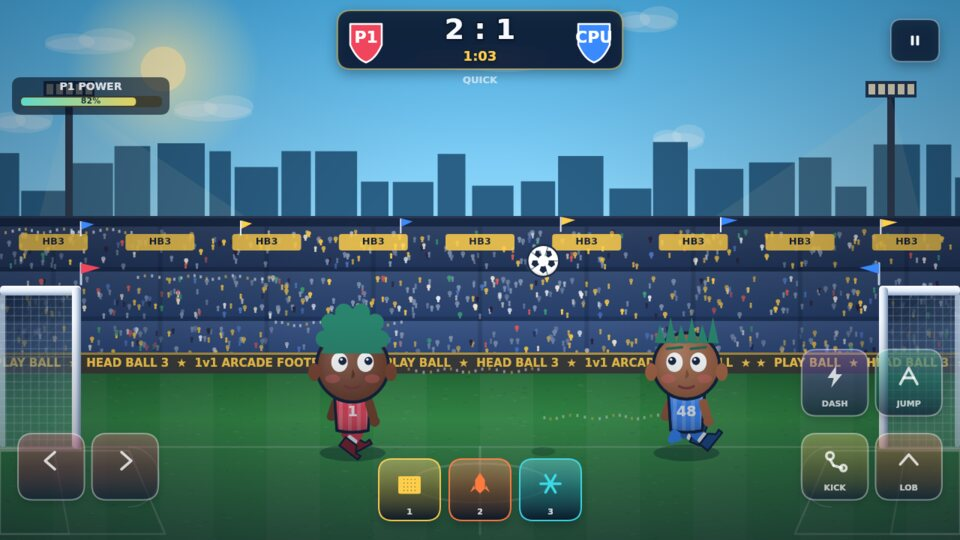
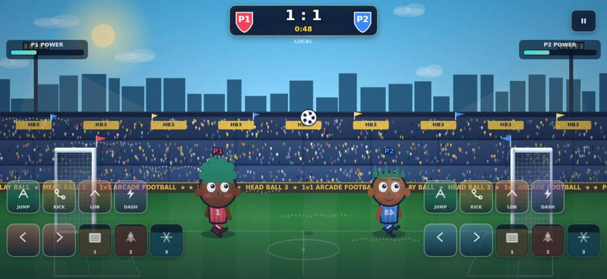

# Head Ball 3

A complete, original **1v1 arcade head-football game** — 90-second matches,
big-headed heroes, superpowers, leagues, cups, penalty duels and a two-player
mode on a single phone. It runs from one canvas, ships as a tiny offline
Android APK, and every pixel and every sound is generated by the code itself.




> No sprites, no audio files, no web fonts, no game engine, no third-party
> runtime libraries. `game.js` (≈162 kB minified) *is* the game.

---

## Play

```bash
git clone https://github.com/RadekParek/Head-ball-3.git
cd Head-ball-3
npm install        # terser + a headless canvas for tests (dev only)
npm run build      # → dist/assets/index.html + game.js + style.css
npm run serve      # optional: http://localhost:8080
```

Open `dist/assets/index.html` in any modern browser, or play the APK.

### Controls

| Action | Touch | Player 1 keys | Player 2 keys |
| --- | --- | --- | --- |
| Move | ◀ ▶ bottom-left | `A` / `D` | `←` / `→` |
| Jump | **JUMP** | `W` | `↑` |
| High kick / header | **KICK** | `S` | `↓` |
| Low kick | **LOB** | `E` | `.` |
| Dash | **DASH** | `Q` | `/` |
| Powers | slots `1 2 3` | hold + release | same on the right pad |

In **1v1 on one phone** the pitch is shared and landscape: one mirrored control
cluster on each edge, multi-touch enabled, keyboard also works. Flip the solo
layout in *Settings → Flip controls*.

## What is in the game

* **Match core** — 90 s matches (configurable), goal, golden-goal sudden death,
  headers, volleys, juking, body checks, keeper rushes, turf bounce, screen shake,
  hit-stop, ball trails, crowd reactions and a live power meter.
* **20 superpowers** — freeze, mirror, giant ball, tiny ball, mega goal, goal
  shrink, rocket shot, ice field, teleport, meteor, quake, magnet, shield, ghost
  ball, boomerang, ghost hero, giant hero, turbo, scramble and slow-mo. Each has
  levels and cooldowns; three are equipped at a time.
* **125 heroes, 31 gear items, 10 stadiums**, all drawn from a handful of vector
  primitives with generated names, nations, rarities and stat spreads.
* **Progression** — coins, gems, fans, XP and levels, career goals, five leagues
  with 15 promotion brackets, achievements, daily missions and a daily reward
  streak, card packs, scratch cards and a season track.
* **Career modes** — quick match, league, 8-team knockout cup, penalty duel with
  sudden death, practice, and a simulated "online" quick match ladder.
* **AI** — five difficulty tiers with predictive interception, tactical power
  usage and deliberate imperfection, so matches stay winnable and readable.
* **Audio** — the whole soundtrack is synthesised: five sequenced music themes,
  ~40 sound effects (kicks, headers, whistles, crowds, coins, UI) and a
  reactive crowd bed. Mute/volume sliders live in settings.
* **Persistence** — save is a single JSON blob in `localStorage` in the browser
  and in `SharedPreferences` through the native bridge in the APK.

## Performance and size

| Metric | Value |
| --- | --- |
| Shipped game JS | ≈162 kB minified (one file) |
| HTML + CSS | 606 B + 319 B |
| Audio/image assets | 0 files |
| APK | a few hundred kB, no native libs |

Rendering is a single 2D canvas with cached offscreen stadium layers, a fixed
120 Hz physics step, object pools for particles and no per-frame allocation in
the hot loop. All art is cached at load time, so the frame cost stays flat.

## Build the APK

### GitHub Actions (recommended)

Push to `main`, open a PR, or run **Actions → Build Android APK → Run workflow**.
The workflow installs Node, JDK 17 and the Android SDK, minifies the game, runs
the headless gameplay suite, builds and signs the APK, then uploads it as the
**HeadBall3-apk** artifact. Pushing a `v*` tag also attaches the APK to a GitHub
Release.

### Signed with your own key

The build script uses a release key when these are provided (repository
secrets for CI, environment variables locally). Without them it falls back to an
ephemeral debug key so the APK always builds.

| Secret | Meaning |
| --- | --- |
| `ANDROID_KEYSTORE_BASE64` | your `.jks`/`.keystore`, base64-encoded |
| `ANDROID_KEYSTORE_PASSWORD` | store password |
| `ANDROID_KEY_ALIAS` | key alias |
| `ANDROID_KEY_PASSWORD` | key password (defaults to the store password) |

```bash
base64 -w0 my-release.jks   # paste into the secret
```

### Locally

```bash
export ANDROID_HOME=$HOME/Android/Sdk        # needs platforms;android-35,
                                             # build-tools;35.0.0, JDK 17+
npm run apk                                  # → dist/apk/HeadBall3.apk
```

`android/build.sh` deliberately avoids Gradle and AndroidX: it compiles one
Java file with `javac`, dexes with `d8`, links resources with `aapt2`, adds
`dist/assets` as assets, aligns with `zipalign` and signs with `apksigner`.
If the SDK is missing and `sdkmanager` exists, it installs the needed packages
itself.

## Development

```bash
npm run build     # minify src/js/*.js into dist/assets/game.js
npm run smoke     # 95 headless gameplay assertions (boot, menus, match,
                  # goals, powers, local layout, penalty, save/load)
npm run shot      # render 30 QA screenshots at 16:9 and 20:9
npm run apk       # build the Android package
```

```
src/index.html, src/style.css
src/js/core.js      math, RNG, events, save/load, input
src/js/data.js      content tables + progression rules
src/js/audio.js     procedural WebAudio SFX, crowd and music sequencer
src/js/art.js       cached vector art: stadium, heroes, gear, ball, icons
src/js/match.js     match physics, powers, HUD, control layout
src/js/ai.js        opponent behaviour
src/js/penalty.js   penalty duel mode
src/js/ui.js        immediate-mode canvas UI kit + navigation
src/js/screens.js   every menu and mode screen
src/js/app.js       boot, frame loop, routing, native hooks
scripts/            build, headless harness, smoke tests, screenshots, icon
android/            manifest, resources, one Activity, build.sh
```

Headless tests run the real minified bundle inside a Node canvas, so a broken
build fails CI before an APK is produced.

## License and attribution

Code and art in this repository are MIT licensed — see [LICENSE](LICENSE).
It is an independent work: it contains no Head Ball 2 / Masomo code or assets.
See [NOTICE.md](NOTICE.md) for the full statement, including the reminder to
verify third-party naming rights before publishing.
